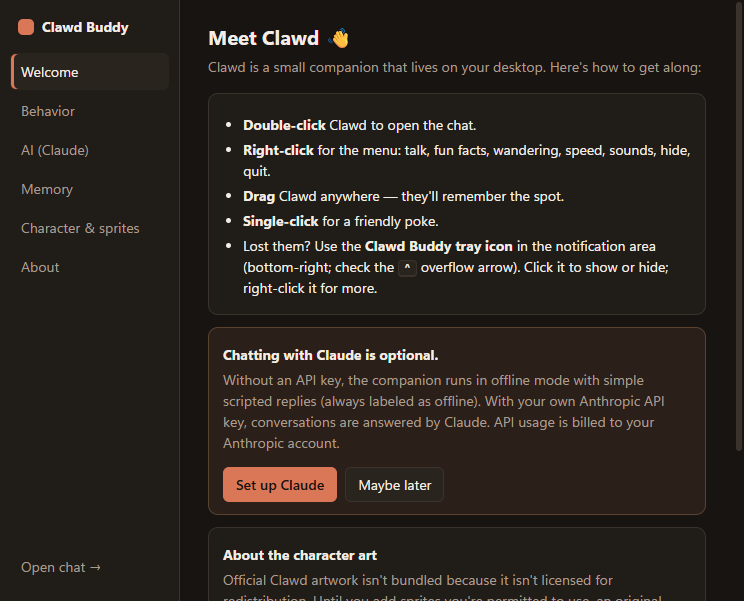

# Clawd Buddy

An unofficial desktop companion inspired by classic desktop pets like BonziBuddy. It walks around your desktop, plays sprite animations, talks in speech bubbles, and can optionally chat with you using Claude.

> **Unofficial fan project.** Clawd Buddy is not made, approved, or endorsed by Anthropic. "Claude" and the Clawd character belong to Anthropic. **No Clawd artwork is included** (see [Artwork](#artwork-and-licensing)); until you add sprites you're permitted to use, an original placeholder character called "Pip" is shown and labeled "placeholder art".

<p align="center">
  
  
</p>
<p align="center">
  
</p>

## Features

- **Desktop character.** A transparent, frameless window that stays on top of other windows (you can turn that off). Clicks pass through to the apps underneath everywhere except on the character itself.
- **Animations.** A deterministic state machine drives idle, walk, think, talk, happy, confused, sleep, wake, and a generic action animation. Missing animations fall back to idle and never crash the app.
- **Wandering.** Now and then the companion strolls along the screen, turns around, and rests. It stays inside the desktop's work area, handles multiple monitors and resolution changes, and remembers where you dragged it.
- **Classic interactions.** Double-click to chat, right-click for a menu, single-click for a poke, and drag to move.
- **Context menu.** Talk to Clawd, Open chat, Tell me something, What can you help with?, Wander toggle, Movement speed, Sounds, Settings, Hide, and Quit.
- **System tray.** Click to show or hide the companion; right-click for chat, settings, toggles, and quit.
- **Chat window.** Claude replies stream in, and you can cancel a reply with *Stop*. Clawd thinks while waiting, talks while streaming, and returns to idle when done.
- **Two ways to reach Claude.** Use your Claude Pro or Max subscription through a locally installed [Claude Code](https://docs.anthropic.com/en/docs/claude-code/setup), or your own Anthropic API key.
- **Offline mode.** Works without either. Replies are simple and scripted, and they're always labeled "Offline mode · scripted reply, not from Claude".
- **Opt-in memory.** Only facts you explicitly approve are saved, and you can view, edit, or delete them at any time.
- **Settings.** Wandering, speed, always-on-top, sounds, character size, launch at startup (off by default), chat window options, AI setup, memory, sprite diagnostics, and reset.
- **Sprite packs.** Add authorized artwork as a folder with a `manifest.json`. A diagnostics panel shows which animations loaded and which fall back.

## Requirements

- Windows 10 or 11 (primary target). The code is kept portable for a later macOS release.
- Node.js 20+ (developed with Node 24) and npm, to build from source.
- Optional, for Claude conversations: [Claude Code](https://docs.anthropic.com/en/docs/claude-code/setup) signed in with a Claude subscription, or an [Anthropic API key](https://console.anthropic.com/settings/keys).

## Development setup

```bash
git clone https://github.com/<owner>/clawd-buddy.git
cd clawd-buddy
npm install
npm start          # build and launch
```

Useful scripts:

| Command | What it does |
| --- | --- |
| `npm start` | Build everything and launch the app |
| `npm run check` | Type-check, lint, unit tests, and build |
| `npm test` | Unit tests (Vitest) |
| `npm run smoke` | Launch the real app against a throw-away profile and run 20 runtime checks (windows, sprites, IPC security, chat, movement, missing assets). Screenshots are saved to `smoke-output/`. |
| `npm run dist` | Build a Windows installer (NSIS) into `release/` |
| `npm run dist:dir` | Build an unpacked app folder (faster, for testing) |
| `npm run assets:placeholder` | Regenerate the placeholder sprites and icons |

## Building a Windows installer

```bash
npm run dist
```

This writes `release/Clawd Buddy Setup <version>.exe`. The installer is per-user, lets you choose the install folder, and creates Start-menu and desktop shortcuts. Builds are **unsigned**, so Windows SmartScreen may warn on first run ("More info → Run anyway"). Signing requires your own code-signing certificate.

## Configuring Claude (optional)

### With your Claude subscription (Claude Code)

1. Install [Claude Code](https://docs.anthropic.com/en/docs/claude-code/setup) (on Windows, the native installer that provides `claude.exe`), run `claude` in a terminal once, and sign in with your Claude account.
2. Open **Settings → AI (Claude)**, set **Connect with** to *Claude subscription (Claude Code)*, and turn on **Enable Claude**.
3. Click **Test connection**. It runs `claude auth status`, which uses no usage, and reports your plan.

How it works: for each message the app starts `claude -p` in an empty folder, with no tools, plugins, hooks, MCP servers, `CLAUDE.md` files, or saved session history, and streams back the reply. Chats count toward your plan's usage limits. Clawd Buddy never reads, copies, or stores Claude Code's sign-in; `ANTHROPIC_API_KEY` is removed from the CLI's environment, so it uses the subscription and doesn't quietly bill an API account. The app looks for `claude.exe` on `PATH` and in `%USERPROFILE%\.local\bin`; npm's `claude.cmd` shim isn't used, because the app never runs commands through a shell.

### With an API key

1. Get an API key from the [Anthropic Console](https://console.anthropic.com/settings/keys).
2. Open **Settings → AI (Claude)** from the tray or the right-click menu.
3. Paste the key and click **Save**. With *Remember key* on, the key is encrypted with your Windows account (DPAPI via Electron `safeStorage`). If OS encryption isn't available, the key is kept only for the current session.
4. Click **Test connection**.

Notes:

- **API key usage is billed to your Anthropic account.** See [pricing](https://www.anthropic.com/pricing).
- The default model is set in one place, `src/shared/constants.ts` (`DEFAULT_MODEL`, currently `claude-opus-5-5`), and can be changed in Settings.
- Replies use low reasoning effort and short answers to suit a chatty companion. The request enables the API's server-side refusal fallback (`fallbacks: "default"`).
- As an alternative to saving a key, the app also reads an `ANTHROPIC_API_KEY` environment variable.

## Artwork and licensing

- **Source code:** [MIT](LICENSE).
- **Placeholder character and icons:** original work made for this project, MIT.
- **Clawd:** Anthropic's character. It is **not** included because I found no official source that licenses it for redistribution. Details are in [ARTWORK.md](ARTWORK.md).

To use Clawd art (or any other character) that you are permitted to use, create a sprite pack. See [assets/sprites/README.md](assets/sprites/README.md). In short:

1. Open **Settings → Character & sprites → Open sprite folder** (`%APPDATA%\Clawd Buddy\sprites`).
2. Create a folder such as `clawd\` containing your frames and a `manifest.json` (see [manifest.example.json](assets/sprites/manifest.example.json)), with honest author, source, and license fields.
3. Click **Reload sprites**.

Never commit artwork you aren't allowed to redistribute. `assets/sprites/local/` and every sprite folder except `placeholder/` are git-ignored.

## Privacy and security

- **Local only.** Settings, memory, and the encrypted API key are stored in `%APPDATA%\Clawd Buddy\`. There's no telemetry or analytics.
- **What leaves your computer.** Only when Claude is enabled and set up: your chat messages, recent conversation context, and memory items you approved go **to Anthropic**, either directly to the API or through your local Claude Code, and nowhere else.
- **What is never collected.** Files, keystrokes, clipboard, browser history, screenshots, or activity in other apps. The only OS signal used is the system idle time, so the companion can nap while you're away. It doesn't monitor other applications.
- **No computer control.** The companion never executes commands or takes actions based on conversation text.
- **Electron hardening.** Context isolation, sandboxed renderers, no Node integration, and a strict Content-Security-Policy. A narrow typed preload API is the only bridge to the main process. Every IPC message is checked against a per-window allow-list (`src/shared/ipc-policy.ts`) and validated before use. Navigation and new windows are blocked, and all permission requests are denied.
- **API key handling.** The key lives only in the main process. It is never sent to a renderer, shown in DevTools, or logged.

See [SECURITY.md](SECURITY.md) for how to report vulnerabilities.

## Troubleshooting

| Problem | Fix |
| --- | --- |
| The companion disappeared | Click the **Clawd Buddy tray icon** (check the `^` overflow area of the taskbar). Starting the app again also brings it back, because only one instance runs. |
| It's in the way | Right-click it and choose **Hide**, turn off **Always on top**, or disable **Wander around**. |
| It ended up off-screen after unplugging a monitor | It moves itself back automatically when displays change. Hide and show it from the tray to force a re-check. |
| "Your API key was rejected" | Re-enter the key in Settings → AI and run **Test connection**. |
| "Claude Code isn't signed in" | Run `claude` in a terminal, sign in, then **Test connection** again. |
| "Claude Code wasn't found" | Install the native Claude Code build, or make sure `claude.exe` is on `PATH`, then **Test connection**. |
| "You've hit your Claude plan's usage limit" | Wait for the limit to reset, or switch to an API key. |
| "That model wasn't found" | Reset the model field in Settings → AI to a suggested value. |
| Rate limited or overloaded | Wait a minute and try again. The app already retries transient errors. |
| My sprite pack doesn't show | Settings → Character & sprites lists each pack with its errors (invalid JSON, missing `idle`, missing files). |
| "Launch at startup" is greyed out | It only works in the installed app, not when running from source. |
| SmartScreen warning on install | The build is unsigned. Choose *More info → Run anyway*, or build it yourself. |

## Taking screenshots

`npm run smoke` saves `companion.png`, `chat.png`, and `settings.png` to `smoke-output/` from a clean profile, so the screenshots contain no personal data. The images in `docs/screenshots/` were produced this way.

## Project layout

```
src/
  main/       Electron main process: windows, tray, IPC, settings, secrets, chat, behavior
  preload/    The narrow, typed bridge (window.clawd)
  renderer/   companion/, chat/, settings/, animation/, styles/
  shared/     Pure, unit-tested logic: state machine, movement, manifest parsing, validation, IPC policy
assets/       Placeholder sprites, icons, sprite-pack docs
scripts/      Build, smoke-test, and asset-generation scripts
tests/        Vitest unit tests
docs/         Implementation plan, progress log, screenshots
```

## Credits

- Inspired by classic desktop companions such as BonziBuddy, and by Anthropic's Clawd mascot.
- Built with [Electron](https://www.electronjs.org/), TypeScript, [esbuild](https://esbuild.github.io/), [Vitest](https://vitest.dev/), and the official [Anthropic TypeScript SDK](https://github.com/anthropics/anthropic-sdk-typescript).

Clawd Buddy is an independent fan project and is not affiliated with Anthropic.
