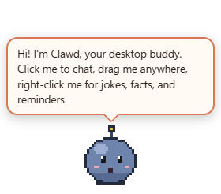
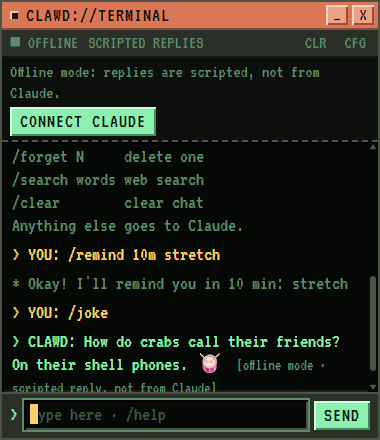

# Clawd Buddy

An unofficial desktop companion in the spirit of BonziBuddy and Clippy, starring Clawd, the pixel mascot of Claude Code. He walks around your desktop, reacts when you pick him up and drop him, tells jokes and fun facts, keeps reminders, and chats with you in a tiny retro terminal, using your Claude subscription, an API key, or simple offline replies.

**Windows and macOS.** On a Mac, start with **[docs/MACOS.md](docs/MACOS.md)** (step by step, no prior experience needed).

> **Unofficial fan project.** Clawd Buddy is not made, approved, or endorsed by Anthropic. "Claude" and Clawd belong to Anthropic. **No Clawd artwork is included in this repository.** If the Claude desktop app is installed on your computer, one click imports Clawd's original animations from it, for use on that computer only ([details](#clawds-artwork)). Until then a simple stand-in character is shown.

<p align="center">
  
  
</p>

## What he does

- **Lives on your desktop.** A transparent, frameless window that stays on top (optional). Only Clawd's visible pixels catch the mouse; everything around him clicks through to the apps underneath. No label or text under him.
- **Click him to chat.** A small terminal-style input line appears right under him (above his head if he's standing on the taskbar). Type, press Enter, and he answers in a pixel-terminal speech bubble that types out like an old computer; long replies scroll. Esc closes it. While Claude answers he thinks, then types on his laptop as the reply streams in, and he stays put while you're typing.
- **Optional chat window.** The full `CLAWD://TERMINAL` window (history, memory approvals) opens from the ▣ button on the input, the right-click menu, or by setting **Chat style** to *Terminal window* in Settings.
- **Pick him up.** Drag him anywhere: he crouches, gets lifted into his carried pose, follows the pointer at your display's full refresh rate, and stays **exactly** where you let go: he lands with a squash and a little hop that bounces lower each time (a transform on the sprite; the window itself doesn't move). Wandering pauses while you hold him.
- **Personality.** Wanders in short trips with pauses, looks around, sways, does a hula, has lightbulb moments, naps (meditates) when you're away, and waves hello. Rub the pointer over him to pet him.
- **Quick actions** (right-click): Chat, Tell a joke, Fun fact, Pet, Do a trick, Reminders, Wander, speed, Sounds, Settings, Hide, Quit.
- **Reminders and to-dos.** "10m stretch", "at 15:30 standup": he pops up with a speech bubble when one is due. A small to-do list too (`/todo buy milk`). Settings → Reminders & to-dos shows an agenda by day. Stored only on your computer.
- **Chat commands:** `/joke`, `/fact`, `/pet`, `/trick`, `/remind`, `/reminders`, `/done`, `/forget`, `/todo`, `/search`, `/clear`, `/help`.
- **Claude, three ways:** your Claude Pro/Max subscription through [Claude Code](https://docs.anthropic.com/en/docs/claude-code/setup), your own Anthropic API key, or offline mode (scripted replies, always labeled as not from Claude).
- **Settings:** chat box color (presets or any color), idle chatter (off / quiet / chatty), animation intensity, reduce motion, sounds, size, always on top, launch at startup, chat history (kept locally, clearable), read replies aloud, opt-in memory.

## Quick start

### Easiest: the launcher (development build)

1. Install [Node.js](https://nodejs.org/) 22 or newer (LTS is fine) and [Git](https://git-scm.com/).
2. Get the project: on the repository's GitHub page click **Code → Copy**, then run `git clone <that URL>` (or **Download ZIP** and unzip it).
3. Double-click the launcher in the project folder:
   - **Windows:** `Launch-ClawdBuddy.bat`
   - **macOS:** `Launch-ClawdBuddy.command` (one-time permission steps are in [docs/MACOS.md](docs/MACOS.md#run-the-launcher))

The launcher finds its own folder, checks Node.js, offers to install the project's dependencies (`npm ci`) if they're missing, and runs `npm start`. It installs nothing globally and needs no admin rights.

### From a terminal

Windows (PowerShell) or macOS (Terminal), inside the project folder:

```
npm ci
npm start
```

### As a standalone app

| | Command | Output in `release/` |
| --- | --- | --- |
| Windows installer | `npm run dist:win` (on Windows) | `Clawd Buddy Setup <version>.exe` |
| macOS app | `npm run dist:mac` (on a Mac) | `.dmg` and `.zip` for Apple Silicon (`arm64`) and Intel (`x64`) |

The packaged app contains everything it needs; the source folder can be deleted afterwards. Builds are **not signed** with a paid certificate: Windows SmartScreen may warn ("More info → Run anyway"), and macOS builds are only ad-hoc signed and not notarized (see [docs/MACOS.md](docs/MACOS.md#install-a-built-app)). Every push also builds both on GitHub Actions; download them from the run's **Artifacts**.

## Clawd's artwork

Clawd's art belongs to Anthropic, so this repository doesn't contain it. The Claude desktop app ships Clawd's original pixel animations (walking, jumping, thinking, typing on a laptop, waving, meditating, and more). Clawd Buddy can import them from your own installation:

1. Install the [Claude desktop app](https://claude.ai/download) (Windows or macOS).
2. In Clawd Buddy: **Settings → Character & sprites → Import Clawd from the Claude app** (also on the Welcome page).

The importer reads the app's files read-only, decodes the animations, aligns every frame on Clawd's feet, and saves them as a private sprite pack in your user folder (`%APPDATA%\Clawd Buddy\sprites\clawd` on Windows, `~/Library/Application Support/Clawd Buddy/sprites/clawd` on macOS). Nothing is uploaded, and the pack never goes into Git. Re-run it after the Claude app updates. See [ARTWORK.md](ARTWORK.md) for details and the frame mapping.

Other artwork you're permitted to use can be added as a sprite pack; see [assets/sprites/README.md](assets/sprites/README.md).

## Configuring Claude (optional)

### With your Claude subscription (Claude Code)

1. Install [Claude Code](https://docs.anthropic.com/en/docs/claude-code/setup), run `claude` in a terminal once, and sign in with your Claude account.
2. **Settings → AI (Claude)**: set **Connect with** to *Claude subscription (Claude Code)* and turn on **Enable Claude**.
3. Click **Test connection**. It runs `claude auth status` (uses no quota) and reports your plan.

For each message the app runs `claude -p` in an empty folder with no tools, plugins, hooks, MCP servers, `CLAUDE.md`, or saved sessions, and streams back the reply. Chats count toward your plan's limits. Clawd Buddy never reads or stores Claude Code's sign-in, and removes `ANTHROPIC_API_KEY` from the CLI's environment so it can't silently bill an API account. It looks for `claude` on `PATH` and in the default install folders (on Windows the native `claude.exe`; npm's `.cmd` shim isn't used because the app never runs a shell).

### With an API key

1. Get a key from the [Anthropic Console](https://console.anthropic.com/settings/keys) (billed per use; see [pricing](https://www.anthropic.com/pricing)).
2. **Settings → AI (Claude)** → paste it → **Save**. With *Remember key* on it's encrypted with your OS account (Windows DPAPI / macOS Keychain via Electron `safeStorage`); otherwise it's kept for the session only. You can also set an `ANTHROPIC_API_KEY` environment variable.
3. **Test connection.**

The default model is set in `src/shared/constants.ts` (`DEFAULT_MODEL`, currently `claude-opus-5-5`) and can be changed in Settings.

## How the motion works

- **One position authority.** Only the main process moves the companion window, through exactly two paths that never overlap: the drag follower and the walk ticker. Grabbing Clawd stops the walk ticker before anything else.
- **Event-driven dragging.** The renderer only reports *press*, *drag start*, *pointer moved*, and *release*. On every pointer event (Chromium delivers one per display frame) the main process reads the OS cursor (`screen.getCursorScreenPoint()`, in the same DIP coordinates as window bounds on Windows and macOS) and moves the window to `cursor − grab offset`. No timer, no queue, no frame cap. On release the window is placed once, exactly at the release point (nudged only if Clawd's body would be off every display).
- **Never stuck.** Releases are detected on the window (not just the sprite), on `buttons === 0`, on blur and Esc, and by a watchdog that ends a hold whose release was never reported. A new press always starts fresh.
- **Visual effects stay inside the window.** Pickup, carried pose, and landing use Clawd's own frames plus a small damped squash-and-stretch spring on the sprite; the window never moves during the landing. Reduce motion turns the spring off.
- **Crisp pixels.** Sprites are drawn with an integer number of device pixels per art pixel for the display's scale factor (100%, 125%, 150%, Retina…).

Measured on a 200 Hz Windows display with real mouse input: the window moved ~185 times per second during drags (about once per display frame), median pointer-to-window gap 3 px at 1200 px/s (about 2.5 ms), and every drop landed exactly. Details and limits are in [docs/PROGRESS.md](docs/PROGRESS.md).

## Development

See **[docs/DEVELOPMENT.md](docs/DEVELOPMENT.md)** for setup on Windows and macOS, moving between computers, and the release process.

| Command | What it does |
| --- | --- |
| `npm start` | Build and launch |
| `npm run check` | Type-check, lint, unit tests, build |
| `npm test` | Unit tests (Vitest) |
| `npm run smoke` | Launch the real app on a throw-away profile and run ~40 runtime checks (windows, drag/drop, hit-testing, chat terminal, commands, reminders, security). Screenshots go to `smoke-output/`. |
| `npm run dist` / `dist:win` / `dist:mac` | Package for the current OS / Windows / macOS |
| `npm run assets:placeholder` | Regenerate the stand-in sprites and icons |

## Privacy and security

- **Local only.** Settings, memory, reminders, chat history, and the encrypted key stay in the app's data folder. No telemetry or analytics.
- **What leaves your computer.** Only when Claude is enabled and set up: your chat messages, recent conversation, and memory items you approved go **to Anthropic** (directly, or through your local Claude Code). `/search` opens your browser only when you type it.
- **Never collected.** Files, keystrokes, clipboard, browsing history, screenshots, window titles, or activity in other apps. The only OS signals used are the mouse position while you drag Clawd and the system idle time (so he can nap).
- **Hardened Electron.** Context isolation, sandboxed renderers, no Node integration, strict CSP, a narrow typed preload API, a per-window IPC allow-list with validated payloads, blocked navigation, and all permission requests denied. See [SECURITY.md](SECURITY.md).

## Troubleshooting

| Problem | Fix |
| --- | --- |
| Clawd disappeared | Click the tray icon (Windows: the `^` overflow area; macOS: the speech-bubble icon in the menu bar). Starting the app again also brings him back. |
| I can't grab him | Grab his body, not the empty space next to him (that's click-through by design). |
| He's in the way | Right-click → Hide, turn off Always on top, or uncheck Wander around. |
| Still the blue stand-in, not Clawd | Settings → Character & sprites → **Import Clawd from the Claude app** (needs the Claude desktop app installed). |
| "Claude Code isn't signed in" / "wasn't found" | Run `claude` in a terminal and sign in, or install Claude Code, then **Test connection**. |
| "You've hit your Claude plan's usage limit" | Wait for it to reset, or switch to an API key. |
| "Your API key was rejected" | Re-enter it in Settings → AI and **Test connection**. |
| Mac: "can't be opened" / "unidentified developer" | See [docs/MACOS.md](docs/MACOS.md#install-a-built-app). |
| "Launch at startup" is greyed out | It only works in the packaged app, not when running from source. |

## Project layout

```
src/main/       Main process: windows, platform adapters, drag/walk controller, chat, reminders, IPC
src/preload/    The narrow, typed bridge (window.clawd)
src/renderer/   companion/ (sprite + hit-testing), chat/ (terminal), settings/, animation/, fonts/
src/shared/     Pure, unit-tested logic: state machine, layout, movement, reminders, manifest, IPC policy
assets/         Stand-in sprites, icons, sprite-pack docs
scripts/        Build, smoke-test, and asset scripts
docs/           macOS guide, development guide, progress log, manual test plan
```

## Credits

- Inspired by BonziBuddy, Clippy, and Anthropic's Clawd.
- Terminal font: [VT323](https://fonts.google.com/specimen/VT323) by Peter Hull, SIL Open Font License 1.1 (`src/renderer/fonts/VT323-OFL.txt`).
- Built with [Electron](https://www.electronjs.org/), TypeScript, esbuild, Vitest, and the official [Anthropic TypeScript SDK](https://github.com/anthropics/anthropic-sdk-typescript).

Source code: [MIT](LICENSE). Clawd Buddy is an independent fan project and is not affiliated with Anthropic.
